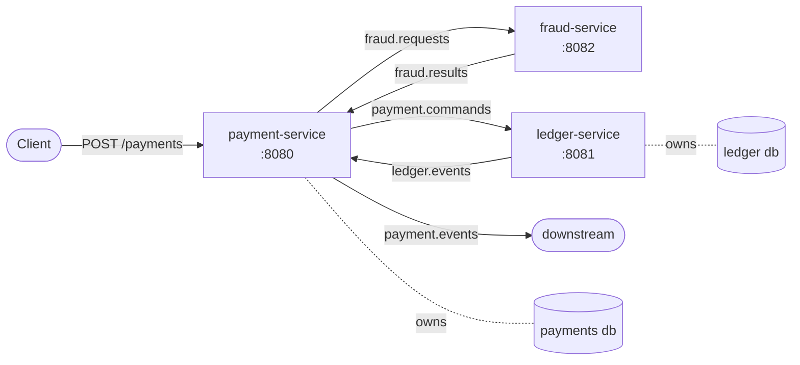

# Payment Processing Platform

An event-driven payment service built around a **double-entry ledger**, designed to
demonstrate **distributed-systems correctness under failure** — not feature breadth.

Money moves between internal accounts through an event-driven saga that **never creates
or loses money, never double-charges on retry, and stays consistent between PostgreSQL
and Kafka even across crashes.**

Four patterns are the point of the project:

| Pattern | Where | What it buys |
|---|---|---|
| **Idempotency** | `payment-service` | A retried `POST /payments` never creates a second payment |
| **Transactional outbox** | `payment-service` | Postgres and Kafka never disagree, even if the process crashes mid-publish |
| **Double-entry + zero-sum invariant** | `ledger-service` | Money is provably never created or destroyed |
| **Saga + compensation** | `payment-service` | Cross-service failures are undone forward, not rolled back |

---

## Architecture

Three services, each owning its own PostgreSQL database (no shared tables); they
communicate **only** through Kafka topics.



- **payment-service** — the only REST entry point. Owns the saga state machine, the
  idempotency store, and the transactional outbox.
- **ledger-service** — source of truth for balances. Posts balanced debit/credit pairs
  to an immutable journal; enforces the zero-sum invariant.
- **fraud-service** — stateless screening (amount ceiling + per-account velocity window);
  emits an approve/reject verdict.

### Saga state machine

```
PENDING ──PaymentInitiated published──▶ FRAUD_CHECK
FRAUD_CHECK ──FraudApproved──▶ POSTING
FRAUD_CHECK ──FraudRejected──▶ FAILED
POSTING ──LedgerPosted──▶ COMPLETED
POSTING ──LedgerRejected──▶ COMPENSATING ──▶ FAILED
```

**Happy path:** `POST` → outbox → `fraud.requests` → fraud approves → `payment.commands`
→ ledger posts → `ledger.events` → `COMPLETED`.

**Failure paths:** fraud rejection (e.g. over the amount limit) → `FAILED` before any
money moves; or an insufficient-funds `LedgerRejected` → `COMPENSATING → FAILED`. The
compensating action is the `PaymentFailed` event (spec §8: failures are undone forward
with compensating events). No money moves before a rejection, so no financial reversal
is required in these paths.

### Topics

| Topic | Produced by | Consumed by | Key |
|---|---|---|---|
| `fraud.requests` | payment | fraud | `fromAccountId` |
| `fraud.results` | fraud | payment | `paymentId` |
| `payment.commands` | payment | ledger | `fromAccountId` |
| `ledger.events` | ledger | payment | `fromAccountId` |
| `payment.events` | payment | (downstream) | `paymentId` |
| `*.DLT` | error handlers | (manual inspection) | — |

---

## The core patterns, briefly

**Why the outbox exists (the dual-write problem).** Writing to the database *and*
publishing to Kafka are two systems that can't be committed atomically — a crash between
them leaves the two permanently disagreeing. Instead we write the business row **and** an
`outbox` row in one DB transaction, and a relay publishes outbox rows to Kafka afterward.
Delivery is **at-least-once**; consumers dedupe.

**Idempotency.** `POST /payments` requires an `Idempotency-Key`. The key is a unique
primary key, so a duplicate request fails the insert and replays the stored response. A
key reused with a *different* body is rejected (409).

**Double-entry + zero-sum invariant.** Every transfer is one `DEBIT` + one `CREDIT` under
a shared `transfer_id`, written in a single transaction. `UNIQUE(transfer_id, account_id,
direction)` makes a redelivered posting a no-op (consumer idempotency). Balances use
optimistic locking (`@Version`); to avoid deadlocks, the two balance rows are always
updated in a consistent account-id order.

**Saga + compensation.** The payment orchestrator consumes `fraud.results` and
`ledger.events` and advances the state machine with **race-safe conditional updates**
(`UPDATE ... WHERE status IN (...)`); the rows-affected count gates the outbound event so
it fires exactly once. Handlers are re-entrant, so a redelivered event resumes from the
persisted state.

**Dead-letter topic.** Both consumers use a `DefaultErrorHandler` with bounded retries,
then route the poison record to `<topic>.DLT` (headers + failure reason preserved). The
partition keeps flowing — a poison message quarantines itself instead of wedging the log.

### Partition-key tradeoff (spec §6)

Kafka orders only *within* a partition. Keying by account gives per-account ordering, but
a transfer touches two accounts, so topic ordering can't cover both sides. **Decision:**
key by the debited (`from`) account for the common case, and treat the **ledger's DB
transaction + `account_balances.version`** as the real correctness boundary. Ordering is
an optimization; the invariant is enforced in the database, not the log.

---

## Tech stack

Java 21 · Spring Boot 3.3 · Spring for Apache Kafka · Spring Data JPA · PostgreSQL 16 ·
Kafka (KRaft, single broker) · Flyway · Maven (multi-module) · Docker Compose ·
Testcontainers + JUnit 5.

**Money rule:** all amounts are integer **minor units** (cents) with an explicit
currency — never `float`/`double`.

---

## Running it

```bash
docker compose up -d --wait
```

Brings up Kafka, Postgres (two databases), and all three services. Then:

```bash
# Fund an account in the ledger (opening balance)
docker exec pp-postgres psql -U payments -d ledger -c "INSERT INTO accounts(id,currency) VALUES ('11111111-1111-1111-1111-111111111111','USD'); INSERT INTO account_balances(account_id,balance_minor,version) VALUES ('11111111-1111-1111-1111-111111111111',1000000,0);"

# Make a payment (returns 201 PENDING; the saga drives it to COMPLETED)
curl -X POST http://localhost:8080/payments \
  -H "Idempotency-Key: demo-1" -H "Content-Type: application/json" \
  -d '{"fromAccountId":"11111111-1111-1111-1111-111111111111","toAccountId":"22222222-2222-2222-2222-222222222222","amountMinor":2500,"currency":"USD"}'
```

### Tests

```bash
./mvnw test
```

15 integration tests run against **real** Postgres + Kafka (Testcontainers, no mocks),
covering every required scenario from the spec: concurrent duplicate idempotency keys,
outbox-crash delivery, the zero-sum invariant (sequential + concurrent), consumer killed
mid-saga, and poison-message → DLT.

---

## Measured results

From the load driver (`load-test/LoadTest.java`, Java 21 virtual threads) against the
Docker Compose stack:

- **Correctness under a 2,000-payment concurrent burst:** 2,000/2,000 reached
  `COMPLETED`, with **zero balance drift** (ledger total exactly equal to the opening
  total) and exact double-entry balancing (`debits == credits`, 2 journal entries per
  payment).
- **Chaos run:** the ledger service was **hard-killed mid-flight and restarted** during a
  400-payment batch → **400/400 completed, zero drift, exactly 2 entries per payment**
  (no double-posting — redeliveries were deduped by the unique constraint).
- **Submit throughput:** ~366 `POST /payments`/sec, p99 ≈ 1 s at concurrency 64
  (connection-pool bound).

**Known throughput ceiling (honest):** end-to-end drain is bounded by the outbox relay,
which is single-threaded, blocks on each message's broker ack, and drains strictly FIFO
by id. Under a burst this queues, so end-to-end *latency* is dominated by queueing, not
processing. Scaling it is a known next step: batch the sends, run multiple relay workers,
or replace the poller with Debezium CDC on the outbox table.

---

## Intentionally out of scope

Real payment-rail integration, auth beyond a stub, a UI, and (per spec §7/§10, optional)
Avro + Schema Registry and Prometheus/Grafana dashboards. The money-reversal flavor of
compensation has a documented hook (`PaymentSaga.compensate`) but isn't triggered — the
sequential saga rejects before any money moves, so there is nothing to reverse.
